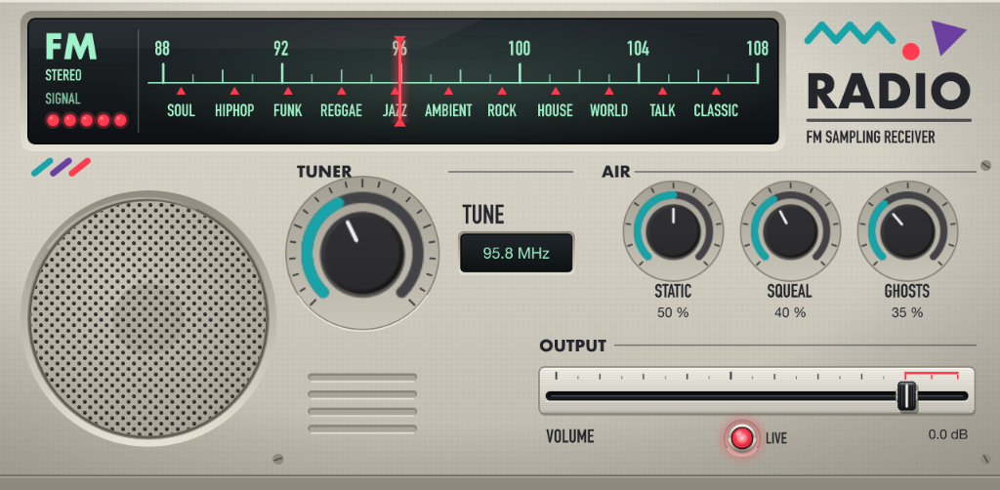
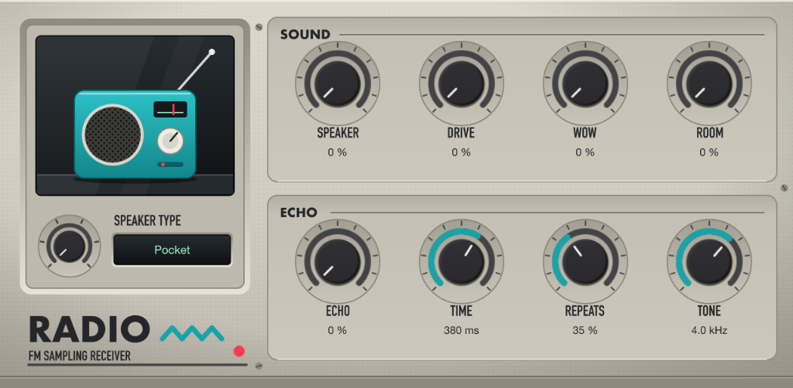

# MPC Radio

An effect for the Akai MPC, by Steph.

MPC Radio is a radio dial that plays live internet stations, with hiss, crackle, sliding whistles and half-heard ghosts between them and a perfectly clean signal once a station locks in. You can then push it through a choice of speakers and add overdrive, tape wobble, room and echo, so it is something to reach for when you want radio sound to sample, from clean music to pure between-station dirt. It plays by itself and replaces whatever is on the track, and it needs the MPC to be online; without a connection you get static and whistles only.

## The MAIN page

| Control | What it does | Starts at | Hardware knob |
|---|---|---|---|
| **Tune** | The radio dial. Land on a station and, after a moment of static while it arrives, it plays clean; move a little off and it turns thin and gritty, then gives way to hiss, whistles and ghosts until the next station. | 95.8 MHz | 13 |
| **Static** | The hiss and crackle heard between stations, louder as you turn it up. All the way down, the gaps between stations are silent, and a locked station has no hiss wherever this is set. | 50 % | 14 |
| **Squeal** | The whistles that slide in pitch as you tune, dropping lower as you close in on a station and vanishing once it locks. Turning it up makes them louder. | 40 % | 15 |
| **Ghosts** | How much of the nearby station bleeds through when the dial sits between frequencies, muffled and fading in and out. Turning it up brings more of it through. | 35 % | 16 |
| **Volume** | The overall output level of the radio, and nothing else. | 0.0 dB | 9 |

## The FX page

| Control | What it does | Starts at | Hardware knob |
|---|---|---|---|
| **Speaker** | How far the sound goes towards the speaker chosen with Speaker Type. All the way down the radio is full range whatever the type; turning it up brings in more of that speaker's character without changing the loudness much. | 0 % | 13 |
| **Drive** | An overdriven amplifier. Turning it up makes the radio grittier and more crushed without making it louder. | 0 % | 14 |
| **Wow** | A tape-style wobble in pitch. Turning it up makes the wobble deeper and more seasick; all the way down it is off. | 0 % | 15 |
| **Room** | Puts a small room around the radio, like a set playing in a kitchen. Turning it up adds more of the room. | 0 % | 16 |
| **Echo** | How loud the echo is. All the way down there is no echo. | 0 % | 9 |
| **Echo Time** | The gap between echoes, from a quick slap to a long delay. Moving it while sound is playing bends the pitch of the echoes, the way a tape echo does. | 380 ms | 10 |
| **Repeats** | How many times the echo comes back. Low gives one or two repeats; high keeps them going for a long time. | 35 % | 11 |
| **Echo Tone** | How bright the echoes are. Turned down, each repeat gets darker and duller; turned up, they stay crisp. | 4.0 kHz | 12 |
| **Speaker Type** | Chooses the speaker that the Speaker control moves towards, and can be changed smoothly while recording. Pocket is a small plastic transistor radio with no bass and no top, Boombox has a thump underneath and a bright top in stereo, Car is boomy, dull and close, Phone is a hard, nasal telephone earpiece in mono, Wood is a boxy, warm old cabinet set in mono, and Horn is a honking, overdriven tannoy in mono. Settings: Pocket, Boombox, Car, Phone, Wood, Horn. | Pocket | 5 |

## Presets

- **Late Night Jazz** The jazz station, clean and full range with no effects; these are the same settings the plugin starts on.
- **Kitchen Hip Hop** The hip hop station through the small Pocket speaker with a little overdrive and some room around it.
- **Between Stations** The dial parked off any station: heavy static, loud whistles and ghosts, through a touch of Wood speaker with wobble, room and a dark echo.
- **Soul On The Phone** The soul station squeezed through the Phone speaker, hard and nasal, with a little overdrive and wobble.
- **Dub Talk** The talk station through the Horn speaker with a dark echo that repeats for a long time and a little room.
- **Warped Classic** The classical station at full range with a deep tape wobble, some room and a bright echo.
- **Clean House** The house station completely clean, with static, whistles, ghosts and every effect turned off; good for straight sampling.
- **Drift Off** The ambient station made hazier with a gentle wobble, plenty of room, a slow soft echo and stronger ghosts when you drift off it.
- **Live Soul 45s** The soul station through the warm, boxy Wood speaker with a little overdrive and wobble, like an old set playing records.
- **Live Dub Reggae** The reggae station through the Boombox speaker with a dark echo that repeats for a long time and a little room.
- **Live Kitchen Talk** The talk station through the small Pocket speaker with a little overdrive and room, like a radio left on in the kitchen.
- **Car Radio Rock** The rock station through the boomy, dull Car speaker with just a touch of room.

## Things to try

1. Load Late Night Jazz and turn Tune slowly away from the station, listening for the music going thin and gritty, the whistle rising and the hiss taking over.
2. Load Car Radio Rock and step through Speaker Type, listening to how each speaker reshapes the same station, then pull Speaker down to hear it open back up to full range.
3. Load Dub Talk and move Echo Time while someone is speaking to hear the repeats bend in pitch like a tape echo.
4. Load Between Stations and ride Static, Squeal and Ghosts while recording to capture pure radio dirt with half-heard music underneath.
5. Load Clean House, then bring up Wow and Room a little at a time and listen for the clean station turning into a worn tape playing in another room.

## Put it on your MPC

1. Download the zip from the [latest release](https://github.com/Forge-Audio/mpc-radio/releases/latest) and unzip it. It holds one folder, `Steph - VST - MPC Radio`.
2. Copy that folder into a folder called `VST2 Plugins` at the top of a USB drive or SD card.
3. Put the drive in the MPC and restart the MPC's app.
4. On the MPC, open the list of plugins. It is under External Plugins, by Steph. It is an effect, so it goes on an insert.

The MPC needs MPC OS 3.10.1 or later, with External Plugin Support switched on under Preferences, Enhancements (Beta). This plugin brings in sound from the internet, so the MPC also has to be on a network with a way out to it.

Made with [MP Forge](https://forge-audio.github.io/mp-forge/).
